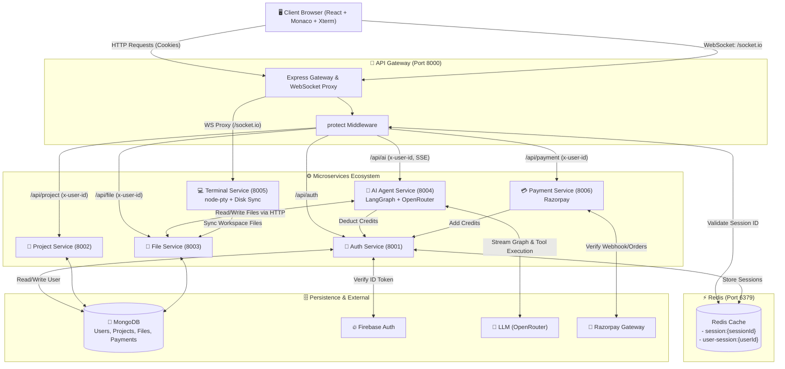

# 🚀 Aether IDE

A modern, full-stack, cloud-based interactive code editor inspired by Cursor and VS Code. It features real-time terminal emulation, agentic AI-driven code modification via LangGraph, file tree exploration with virtual filesystem synchronization, MongoDB persistence, Redis-backed session management, and integrated Razorpay billing.

---

## 📑 Table of Contents
1. [System Architecture Overview](#-system-architecture-overview)
2. [End-to-End Workflow Diagram](#-end-to-end-workflow-diagram)
3. [Why Redis is Used](#-why-redis-is-used)
4. [Technology Stack](#-technology-stack)
5. [Database Schemas & Models](#-database-schemas--models)
6. [API Endpoints Reference](#-api-endpoints-reference)
7. [Service-by-Service Breakdown](#-service-by-service-breakdown)
8. [Setup & Installation Guide](#-setup--installation-guide)
9. [Environment Variables Reference](#-environment-variables-reference)

---

## 🏛 System Architecture Overview

The application follows an **API Gateway & Microservices Architecture**:

- **Frontend (Vite + React 19 + Tailwind CSS + Monaco Editor + Xterm.js)**:
  Single-page IDE interface delivering real-time code editing, live terminal sessions over WebSockets, AI agent chat with streaming server-sent events (SSE), credit balance management, and workspace management.
- **API Gateway (`Port 8000`)**:
  The single point of entry for frontend HTTP requests and WebSocket upgrades. Validates user sessions stored in Redis, extracts user context, injects `x-user-id` forwarding headers, and proxies requests to downstream internal services.
- **Downstream Services**:
  - **Auth Service (`Port 8001`)**: Firebase token authentication, user profile management, session creation in Redis, credit top-ups/deductions.
  - **Project Service (`Port 8002`)**: Project workspaces lifecycle (CRUD, starred projects, metadata).
  - **File Service (`Port 8003`)**: Hierarchical virtual file system stored in MongoDB (files, directories, trees, code contents).
  - **AI Service (`Port 8004`)**: LangChain + LangGraph agentic loop powered by OpenRouter / LLMs with direct tool execution on the virtual filesystem. Streams real-time updates via Server-Sent Events (SSE).
  - **Terminal Service (`Port 8005`)**: Spawns pseudo-terminals (`node-pty`) on temporary host disk workspaces synchronized from the File Service; connects to `xterm.js` via `socket.io`.
  - **Payment Service (`Port 8006`)**: Razorpay order generation, signature verification, and automated wallet credit allocation.

---

## 🔄 End-to-End Workflow Diagram

### High-Level Architecture & Request Flow



### 1. Authentication & Session Flow
1. User logs in with Google/Email on the frontend via **Firebase SDK**.
2. Frontend receives the Firebase `idToken` and submits it to `POST /api/auth/login`.
3. Auth Service verifies the `idToken` against Firebase Admin SDK, provisions/fetches the user in MongoDB, generates a cryptographically secure `sessionId`, and writes session state into Redis.
4. An `HttpOnly` cookie containing the `sessionId` is set in the client's browser.
5. All subsequent requests go through Gateway's `protect` middleware, which validates `sessionId` in Redis in $O(1)$ time and sets `req.user`.

### 2. AI Code Generation & Modification Flow
1. User prompts the AI agent in the IDE sidebar (e.g. *"Create a React counter component"*).
2. Gateway proxies the SSE stream to the **AI Service** (`POST /api/ai/chat`).
3. AI Service initializes a LangGraph state machine compiled with filesystem tools:
   - `get_tree`: Inspects project directory structure.
   - `get_file`: Reads exact file content.
   - `create_folder` & `create_file`: Creates nodes in the File Service.
   - `update_file`: Modifies existing code content.
   - `delete_file`: Removes items.
4. AI service deducts 10 credits per prompt from the user wallet.
5. While generating and calling tools, it pushes Server-Sent Events (`tool_start`, `message`, file mutation events, `done`) back to the frontend to update Monaco Editor and File Tree in real-time.

### 3. Interactive Web Terminal Flow
1. IDE opens an integrated terminal powered by `@xterm/xterm`.
2. Frontend initiates a WebSocket connection to `ws://localhost:8000/socket.io`.
3. Gateway upgrades the connection and routes traffic to the **Terminal Service**.
4. The Terminal Service fetches the full project tree from the **File Service**, synchronizes and writes the code files onto a dedicated scratch directory (`temp/vertex-ai/{projectId}`).
5. It spawns a native PTY process (`powershell.exe` on Windows or `bash` on Linux/macOS) bound to that directory.
6. Keystrokes from `xterm.js` stream through `terminal:write` and terminal standard output streams back via `terminal:data`.

---

## ⚡ Why Redis is Used

Redis plays an essential role in ensuring high performance, security, and low latency across the microservices ecosystem:

1. **Ultra-Fast Session Verification ($O(1)$)**:
   - Every single API request to the API Gateway passes through the `protect` middleware.
   - Querying MongoDB for user authentication on every microservice call would create a bottleneck and introduce high database I/O latency.
   - Redis stores session JSON strings (`session-${sessionId}`) with a 7-day TTL (`EX 604800`), allowing sub-millisecond authentication checks before forwarding requests.
2. **Reverse Session Lookup & Invalidation**:
   - `user-session-${userId}` maps a user ID directly to their active `sessionId`.
   - When a user logs out, their session can immediately be evicted (`DEL`).
   - When credit balance updates occur (e.g. AI usage or payment completion), the Redis session cache is dynamically refreshed with the new balance, avoiding stale cache reads without forcing a re-login.
3. **Decoupled Stateless Services**:
   - Downstream services (Project, File, AI, Payment) don't need access to session stores or authentication databases; the Gateway validates the session via Redis and forwards the validated `x-user-id` header downstream.

---

## 🛠 Technology Stack

### Frontend
- **Framework**: [React 19](https://react.dev/) + [Vite 8](https://vitejs.dev/)
- **Styling**: [Tailwind CSS 4](https://tailwindcss.com/)
- **Code Editor**: [@monaco-editor/react](https://github.com/suren-atoyan/monaco-react) (VS Code's editor in the browser)
- **Terminal UI**: [@xterm/xterm](https://xtermjs.org/) + `@xterm/addon-fit`
- **State Management**: [Redux Toolkit](https://redux-toolkit.js.org/) & React Redux
- **Icons & Animation**: [Lucide React](https://lucide.dev/), [React Icons](https://react-icons.github.io/react-icons/), [Motion (Framer Motion)](https://motion.dev/)
- **Networking & Realtime**: [Axios](https://axios-http.com/), [Socket.IO Client](https://socket.io/), Native EventSource / Fetch Streams
- **Authentication**: [Firebase Web SDK](https://firebase.google.com/)

### Backend & Infrastructure
- **Core Platform**: [Node.js (ES Modules)](https://nodejs.org/) + [Express 5](https://expressjs.com/)
- **API Gateway & Routing**: `express-http-proxy`, `http-proxy`, `cookie-parser`, `morgan`
- **Cache & Session Management**: [Redis](https://redis.io/) via `ioredis`
- **Database**: [MongoDB](https://www.mongodb.com/) via `mongoose`
- **AI Agentic Framework**: [LangChain](https://js.langchain.com/), [@langchain/langgraph](https://github.com/langchain-ai/langgraphjs), [@langchain/openrouter](https://openrouter.ai/)
- **Terminal Emulation**: [node-pty](https://github.com/microsoft/node-pty) + [Socket.IO](https://socket.io/)
- **Authentication & Validation**: [Firebase Admin SDK](https://firebase.google.com/docs/admin/setup), [Zod](https://zod.dev/)
- **Payments**: [Razorpay SDK](https://razorpay.com/docs/payments/server-integration/nodejs/)
- **Containers**: [Docker](https://www.docker.com/) & Docker Compose

---

## 🗄 Database Schemas & Models

### 1. User Model (`auth-service/models/user.model.js`)
Stores registered users, identity provider identifiers, and credit balances.

| Field | Type | Attributes | Description |
| :--- | :--- | :--- | :--- |
| `_id` | `ObjectId` | Auto-generated | Unique User identifier |
| `firebaseUid` | `String` | `required`, `unique`, `trim` | UID provided by Firebase Auth |
| `name` | `String` | `required`, `trim` | Display name of the user |
| `email` | `String` | `required`, `unique`, `trim`, `lowercase` | Email address |
| `avatar` | `String` | `default: ""` | URL to profile avatar |
| `credits` | `Number` | `default: 100`, `min: 0` | Available balance for AI interactions |
| `createdAt` | `Date` | Timestamp | Auto-created timestamp |
| `updatedAt` | `Date` | Timestamp | Auto-updated timestamp |

### 2. Project Model (`project-service/models/project.model.js`)
Represents an individual workspace or coding project owned by a user.

| Field | Type | Attributes | Description |
| :--- | :--- | :--- | :--- |
| `_id` | `ObjectId` | Auto-generated | Project identifier |
| `owner` | `ObjectId` | `ref: 'User'`, `required` | ID of the user who owns the project |
| `name` | `String` | `required` | Project display name |
| `description` | `String` | Optional | Project description / notes |
| `starred` | `Boolean` | `default: false` | Bookmark / favorite flag |
| `lastOpenedAt` | `Date` | `default: Date.now` | Last timestamp project was accessed |
| `createdAt` | `Date` | Timestamp | Project creation time |
| `updatedAt` | `Date` | Timestamp | Project update time |

### 3. File Model (`file-service/models/file.model.js`)
Represents virtual directories and files within a project, forming a recursive tree structure.

| Field | Type | Attributes | Description |
| :--- | :--- | :--- | :--- |
| `_id` | `ObjectId` | Auto-generated | File/Folder identifier |
| `owner` | `ObjectId` | `ref: 'User'`, `required` | Owner user ID |
| `projectId` | `ObjectId` | `ref: 'Project'`, `required` | Associated project ID |
| `parentId` | `ObjectId` | `ref: 'File'`, `default: null` | Parent folder ID (`null` for root folder) |
| `name` | `String` | `required` | File or folder name (e.g., `App.jsx`, `src`) |
| `type` | `String` | `enum: ['file', 'folder']`, `required` | Distinguishes files from directories |
| `extension` | `String` | `default: ""` | File extension without dot (e.g. `js`, `json`) |
| `language` | `String` | `default: 'plaintext'` | Syntax highlighting key (e.g., `javascript`) |
| `content` | `String` | `default: ""` | Code / text content of the file |
| `size` | `Number` | `default: 0` | Size in bytes |
| `isDeleted` | `Boolean` | `default: false` | Soft-deletion flag |
| `createdAt` | `Date` | Timestamp | Creation timestamp |
| `updatedAt` | `Date` | Timestamp | Last modified timestamp |

### 4. Payment Model (`payment-service/models/payment.model.js`)
Audit trail for Razorpay transactions and credit pack purchases.

| Field | Type | Attributes | Description |
| :--- | :--- | :--- | :--- |
| `_id` | `ObjectId` | Auto-generated | Payment record ID |
| `userId` | `ObjectId` | `ref: 'User'`, `required` | User purchasing credits |
| `plan` | `String` | `enum: ['pro', 'team']`, `required` | Plan key |
| `amount` | `Number` | `required` | Amount in smallest currency unit (paise) |
| `credits` | `Number` | `required` | Number of credits granted |
| `currency` | `String` | `default: 'INR'` | Currency code |
| `razorpayOrderId` | `String` | `required` | Order ID returned by Razorpay API |
| `razorpayPaymentId`| `String` | `default: null` | Transaction ID after successful payment |
| `status` | `String` | `enum: ['paid', 'created', 'failed']` | Current payment status |
| `createdAt` | `Date` | Timestamp | Transaction creation timestamp |
| `updatedAt` | `Date` | Timestamp | Transaction updated timestamp |

---

## 🔌 API Endpoints Reference

All client calls go to the **Gateway (`http://localhost:8000`)**. The Gateway authenticates cookies and forwards requests to internal microservices.

### 🔑 Authentication Service (`/api/auth`)
| Method | Endpoint | Access | Description |
| :--- | :--- | :--- | :--- |
| `POST` | `/api/auth/login` | Public | Validates Firebase token, creates user & Redis session |
| `GET` | `/api/auth/logout` | Public | Clears session cookie and deletes key in Redis |
| `POST` | `/api/auth/user/deduct-credits` | Internal | Decrements user credits and syncs Redis session |
| `POST` | `/api/auth/user/add-credits` | Internal | Increments user credits and syncs Redis session |
| `GET` | `/api/me` | Protected | Returns current authenticated user from Redis session |

### 📁 Project Service (`/api/project`)
| Method | Endpoint | Access | Description |
| :--- | :--- | :--- | :--- |
| `POST` | `/api/project/` | Protected | Creates a new project and triggers root folder creation |
| `GET` | `/api/project/` | Protected | Lists all projects owned by the user |
| `GET` | `/api/project/starred`| Protected | Lists starred projects for quick access |
| `GET` | `/api/project/:id` | Protected | Retrieves project details by ID |
| `PATCH`| `/api/project/:id` | Protected | Toggles starred status of a project |
| `DELETE`| `/api/project/:id`| Protected | Deletes a project and its associated files |

### 📄 File Service (`/api/file`)
| Method | Endpoint | Access | Description |
| :--- | :--- | :--- | :--- |
| `POST` | `/api/file/create-root-folder` | Protected | Initializes the root workspace folder for a project |
| `POST` | `/api/file/create-folder` | Protected | Creates a subdirectory under a parent folder |
| `POST` | `/api/file/create-file` | Protected | Creates a new code file |
| `POST` | `/api/file/update/:id` | Protected | Updates the text/code content of a file |
| `GET` | `/api/file/:id` | Protected | Fetches file metadata and content |
| `DELETE`| `/api/file/:id` | Protected | Deletes a file or recursively marks folder deleted |
| `GET` | `/api/file/tree/:projectId` | Protected | Returns complete hierarchical folder/file tree |

### 🤖 AI Service (`/api/ai`)
| Method | Endpoint | Access | Description |
| :--- | :--- | :--- | :--- |
| `POST` | `/api/ai/chat` | Protected | Initiates LangGraph agent conversation (SSE streaming) |

**SSE Events emitted by `/api/ai/chat`:**
- `start`: AI initialization confirmation.
- `tool_start`: Emitted when the agent invokes a tool (e.g. `create_file`, `update_file`).
- `file_created` / `file_updated` / `folder_created` / `file_deleted`: Emitted after tool execution.
- `message`: Assistant token or response message.
- `done`: Signifies agent run completion.
- `error`: Error details if generation fails.

### 💻 Terminal Service (`/socket.io`)
| Event Name | Direction | Payload | Description |
| :--- | :--- | :--- | :--- |
| `terminal:init` | Client ➔ Server | `{ projectId, userId, cols, rows }` | Syncs workspace from File API and spawns PTY |
| `terminal:write`| Client ➔ Server | `String` (keystroke / input) | Writes standard input to the PTY process |
| `terminal:resize`| Client ➔ Server | `{ cols, rows }` | Adjusts terminal columns and rows |
| `terminal:data` | Server ➔ Client | `String` (terminal stdout) | Pushes terminal stdout to `xterm.js` |

### 💳 Payment Service (`/api/payment`)
| Method | Endpoint | Access | Description |
| :--- | :--- | :--- | :--- |
| `POST` | `/api/payment/create` | Protected | Creates a Razorpay Order (`pro` or `team` plan) |
| `POST` | `/api/payment/verify` | Protected | Verifies HMAC-SHA256 signature and credits user account |

---

## ⚙️ Service-by-Service Breakdown

```
AI Code Editor/
├── backend/
│   ├── docker-compose.yml       # Spawns Redis container
│   ├── gateway/                 # Express reverse proxy & WebSocket proxy
│   ├── shared/
│   │   └── redis/redis.js       # Shared ioredis client singleton
│   └── services/
│       ├── auth/                # Firebase admin auth, credits, sessions
│       ├── project/             # Project workspace management
│       ├── file/                # MongoDB virtual filesystem & tree builder
│       ├── ai/                  # LangGraph agent with filesystem tools
│       ├── terminal/            # node-pty terminal & socket.io server
│       └── payment/             # Razorpay order creation and HMAC verification
└── frontend/                    # Vite + React 19 IDE application
```

---

## 🚀 Setup & Installation Guide

### Prerequisites
- [Node.js](https://nodejs.org/) (v18 or higher recommended)
- [Docker & Docker Compose](https://www.docker.com/) (for Redis)
- [MongoDB](https://www.mongodb.com/) (local instance or MongoDB Atlas cluster)
- [Firebase Project](https://console.firebase.google.com/) (Web app credentials + Service Account private key)
- [Razorpay Account](https://razorpay.com/) (Key ID & Secret for payments)
- [OpenRouter API Key](https://openrouter.ai/) (or OpenAI/Anthropic keys for LangGraph LLM)

### Step 1: Start Redis
From the `backend` directory, launch Redis using Docker:
```bash
cd backend
docker-compose up -d
```
*Redis will start on port `6379`.*

---

### Step 2: Configure Environment Variables
Create `.env` files in each service directory according to the specifications below:

#### `backend/gateway/.env`
```env
PORT=8000
FRONTEND_URL=http://localhost:5173
REDIS_URL=redis://localhost:6379
AUTH_SERVICE=http://localhost:8001
PROJECT_SERVICE=http://localhost:8002
FILE_SERVICE=http://localhost:8003
AI_SERVICE=http://localhost:8004
TERMINAL_SERVICE=http://localhost:8005
PAYMENT_SERVICE=http://localhost:8006
```

#### `backend/services/auth/.env`
```env
PORT=8001
MONGO_URI=mongodb://localhost:27017/ai-code-editor-auth
REDIS_URL=redis://localhost:6379
NODE_ENV=development
```
*(Place your Firebase `serviceAccountKey.json` inside `backend/services/auth/`)*

#### `backend/services/project/.env`
```env
PORT=8002
MONGO_URI=mongodb://localhost:27017/ai-code-editor-project
FILE_SERVICE_URL=http://localhost:8003
```

#### `backend/services/file/.env`
```env
PORT=8003
MONGO_URI=mongodb://localhost:27017/ai-code-editor-file
```

#### `backend/services/ai/.env`
```env
PORT=8004
OPENROUTER_API_KEY=your_openrouter_api_key_here
FILE_SERVICE_URL=http://localhost:8003
AUTH_SERVICE_URL=http://localhost:8001
```

#### `backend/services/terminal/.env`
```env
PORT=8005
FILE_SERVICE_URL=http://localhost:8003
```

#### `backend/services/payment/.env`
```env
PORT=8006
MONGO_URI=mongodb://localhost:27017/ai-code-editor-payment
AUTH_SERVICE_URL=http://localhost:8001
RAZORPAY_KEY_ID=your_razorpay_key_id
RAZORPAY_KEY_SECRET=your_razorpay_key_secret
```

#### `frontend/.env`
```env
VITE_API_URL=http://localhost:8000
VITE_FIREBASE_API_KEY=your_firebase_api_key
VITE_FIREBASE_AUTH_DOMAIN=your_project.firebaseapp.com
VITE_FIREBASE_PROJECT_ID=your_project_id
VITE_FIREBASE_STORAGE_BUCKET=your_project.appspot.com
VITE_FIREBASE_MESSAGING_SENDER_ID=your_sender_id
VITE_FIREBASE_APP_ID=your_app_id
```

---

### Step 3: Install Dependencies
Run `npm install` in the gateway, each microservice, and frontend:
```bash
# Gateway
cd backend/gateway && npm install

# Services
cd ../services/auth && npm install
cd ../project && npm install
cd ../file && npm install
cd ../ai && npm install
cd ../terminal && npm install
cd ../payment && npm install

# Frontend
cd ../../../frontend && npm install
```

---

### Step 4: Run the Services
Launch the microservices (in separate terminals or via a process manager like PM2 / concurrently):

```bash
# 1. Gateway
cd backend/gateway && npm run dev

# 2. Auth Service
cd backend/services/auth && npm run dev

# 3. Project Service
cd backend/services/project && npm run dev

# 4. File Service
cd backend/services/file && npm run dev

# 5. AI Service
cd backend/services/ai && npm run dev

# 6. Terminal Service
cd backend/services/terminal && npm run dev

# 7. Payment Service
cd backend/services/payment && npm run dev

# 8. Frontend
cd frontend && npm run dev
```

Visit **`http://localhost:5173`** in your browser to start coding with AI!

---

## 🛡 Security & Best Practices

- **Cookie Security**: Authentication session IDs are delivered via `HttpOnly`, `SameSite` cookies to prevent Cross-Site Scripting (XSS) extraction.
- **Service Isolation**: Downstream services (AI, File, Project) run inside a private network or localhost, only accepting requests containing identity verified by the Gateway (`x-user-id`).
- **Filesystem Path Traversal Protection**: The terminal and file services sanitize and validate path segments (`safeName`), mitigating directory traversal exploits (`../`).
- **Payment Verification**: Payments are secured with HMAC-SHA256 signature verification matching Razorpay secrets before wallet credits are allocated.
